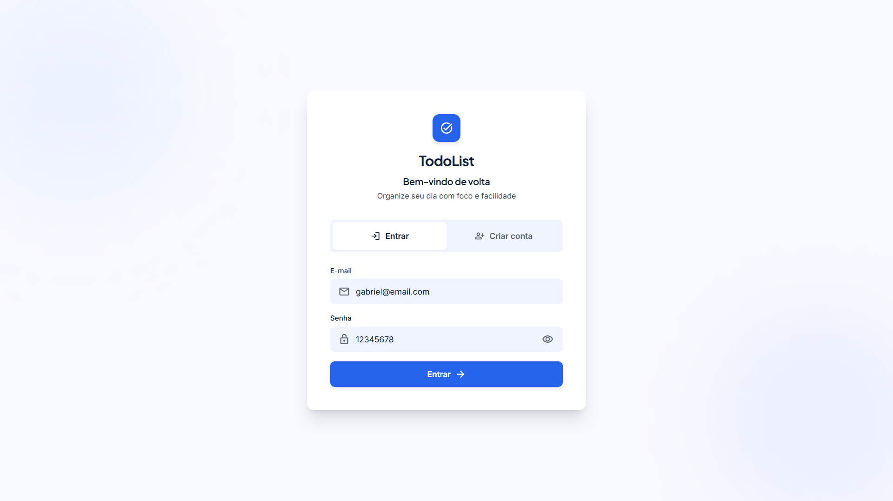
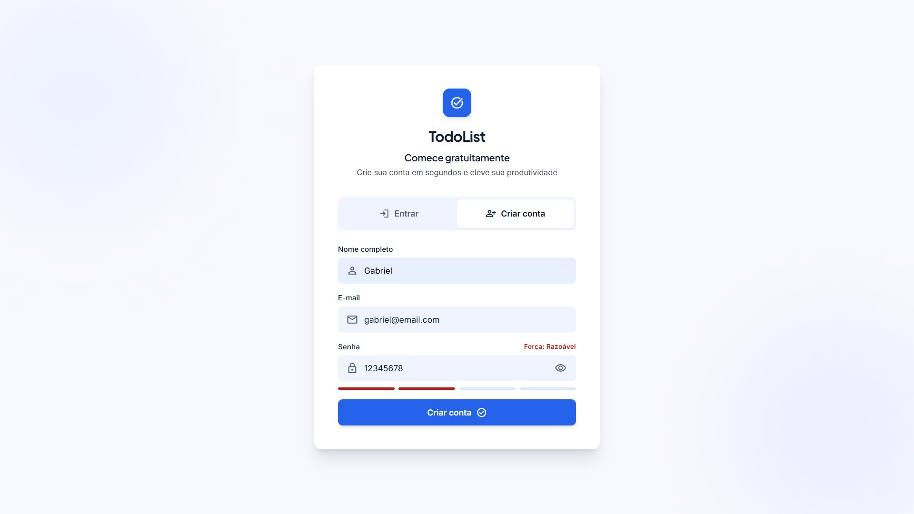
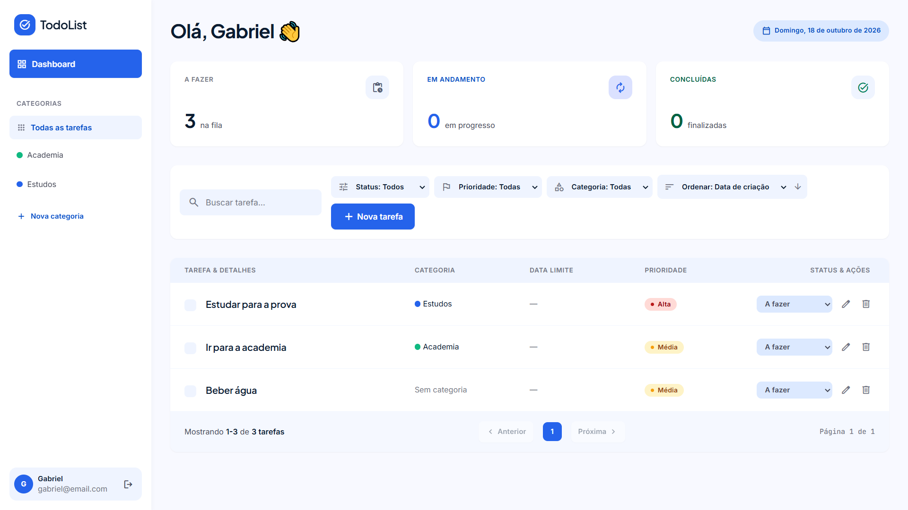
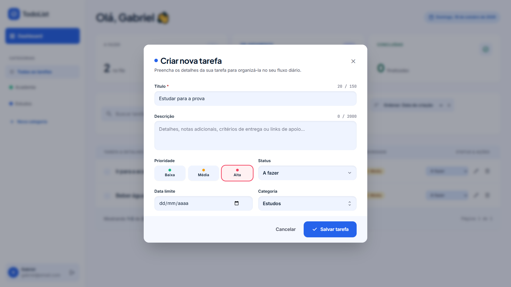
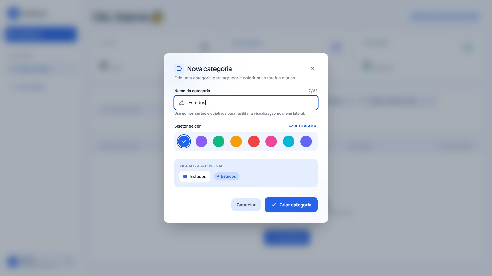

# TodoList

API REST de gerenciamento de tarefas com autenticação JWT, mais um front-end simples que consome a API.

Projeto de portfólio com foco em backend: arquitetura em camadas, segurança, boas práticas REST e persistência de dados.

## Funcionalidades

- Cadastro e login com JWT (senha com hash BCrypt)
- CRUD de tarefas (título, descrição, status, prioridade e data limite)
- CRUD de categorias, com cor
- Filtros por status, prioridade e categoria, busca por texto, ordenação e paginação
- Resumo de tarefas por status
- Cada usuário acessa apenas os próprios dados
- Validação de entrada e erros padronizados em JSON
- Documentação interativa com Swagger

## Tecnologias

- **Backend:** Java 21, Spring Boot 4, Spring Security, Spring Data JPA, Lombok
- **Autenticação:** JWT (JJWT) + BCrypt
- **Banco:** PostgreSQL 16 com migrations Flyway
- **Documentação:** springdoc-openapi (Swagger UI)
- **Testes:** JUnit 5, Mockito, MockMvc e H2 (em memória)
- **Infra:** Docker e Docker Compose
- **Front-end:** HTML, Tailwind CSS e JavaScript puro

## Como rodar

Requisito: Docker instalado.

```bash
docker compose up --build
```

| Serviço | Endereço |
|---|---|
| Front-end | http://localhost:5500 |
| API | http://localhost:8080 |
| Swagger | http://localhost:8080/swagger-ui.html |

Na primeira vez, crie uma conta na tela de login. Os dados do banco ficam salvos em um volume do Docker e continuam existindo depois de parar os containers.

Para apagar tudo, inclusive o banco: `docker compose down -v`.

### Rodando a API sem Docker

Requisito: JDK 21.

```bash
docker compose up -d db
./mvnw spring-boot:run
```

### Testes

```bash
./mvnw test
```

Os testes de integração usam H2 em memória e não precisam do PostgreSQL.

## Endpoints

Todas as rotas, exceto `/api/auth/**`, exigem o cabeçalho `Authorization: Bearer <token>`.

| Método | Rota | Descrição |
|---|---|---|
| POST | `/api/auth/register` | Cadastra e devolve o token |
| POST | `/api/auth/login` | Login e devolve o token |
| GET | `/api/tasks` | Lista com filtros e paginação |
| POST | `/api/tasks` | Cria tarefa |
| GET | `/api/tasks/{id}` | Busca por id |
| PUT | `/api/tasks/{id}` | Atualiza tarefa |
| PATCH | `/api/tasks/{id}/status` | Altera só o status |
| DELETE | `/api/tasks/{id}` | Remove tarefa |
| GET | `/api/tasks/summary` | Contagem por status |
| GET | `/api/categories` | Lista categorias |
| POST | `/api/categories` | Cria categoria |
| PUT | `/api/categories/{id}` | Atualiza categoria |
| DELETE | `/api/categories/{id}` | Remove categoria |

Parâmetros de `GET /api/tasks`: `status`, `priority`, `categoryId`, `search`, `page`, `size`, `sortBy` (`createdAt`, `dueDate`, `title`, `status`) e `direction` (`asc` ou `desc`).

## Estrutura

```
src/main/java/com/tsu/todolist
├── config/          segurança, CORS e Swagger
├── controller/      endpoints REST
├── dto/             objetos de entrada e saída
├── entity/          entidades JPA
├── exception/       exceções e tratamento global de erros
├── repository/      acesso ao banco
├── security/        JWT e filtro de autenticação
├── service/         regras de negócio
└── specification/   filtros dinâmicos de tarefas
src/main/resources/db/migration   scripts do Flyway
frontend/                         telas e JavaScript
```

## Variáveis de ambiente

Opcionais em desenvolvimento, pois há valores padrão.

| Variável | Descrição | Padrão |
|---|---|---|
| `DB_URL` | URL do PostgreSQL | `jdbc:postgresql://localhost:5432/todolist` |
| `DB_USER` / `DB_PASSWORD` | Usuário e senha do banco | `todolist` |
| `JWT_SECRET` | Chave do JWT em Base64 | chave de desenvolvimento |
| `JWT_EXPIRATION_MS` | Validade do token | `86400000` (24h) |
| `CORS_ORIGINS` | Origens permitidas | `*` |

Os valores padrão servem apenas para desenvolvimento. Em produção, defina o `JWT_SECRET` e a senha do banco por variáveis de ambiente.

## Telas

### Login e cadastro
<p>
  
  
</p>

### Dashboard


### Nova tarefa e nova categoria
<p>
  
  
</p>